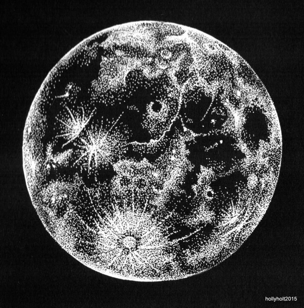

  

<h1 align="center">Hi 👋, I'm Pau</h1>

<h3 align="center">Multiplatform Software Developer · AI</h3>

  

  Building web and mobile apps with a creative mind and a curious eye on AI.

---

<h2 align="center">🚀 About Me</h2>

**Pau**, here — a Multiplatform Software Development (DSM) student who enjoys turning ideas into working apps for web and mobile.

I've worked on real-client projects like a dental clinic management system, a clothing rental platform and a travel package recommender, plus a tourism app built with **Flutter**.

Currently exploring **AI-assisted development** with tools like **Claude Code**, while sharpening my skills in **JavaScript**, **Flutter** and **UI design**.

My goal is simple: write clean code, design with intention, and keep learning — calmly. ☕

 

---

<h2 align="center">🤝 Connect</h2>

  
  &nbsp;
  

<h2 align="center">💻 Tech Stack</h2>

  

<h2 align="center">📊 GitHub Stats</h2>

  

<h2 align="center">📈 Activity Graph</h2>

  

